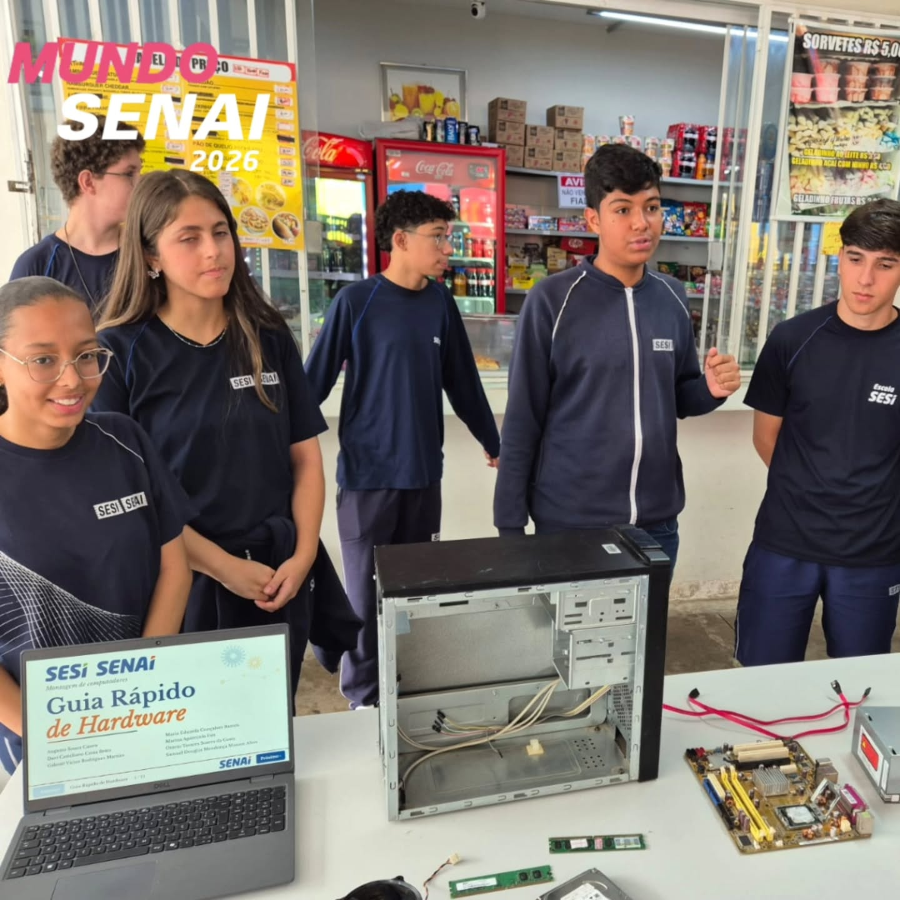

# Guia Rápido de Hardware - Mundo SENAI 2026

## Sobre a Apresentação
* **O que foi apresentado:** Uma apresentação e guia prático interativo sobre peças e componentes de computadores (placa-mãe, processador, memória RAM, armazenamento e fonte), explicando a função de cada item com linguagem simples e visual.
* **Público-alvo:** Visitantes da comunidade, estudantes de outras turmas e docentes do SENAI.
* **Meu papel:** Responsável pela estruturação do conteúdo explicativo, organização da interface no estande e apresentação prática das peças físicas e do sistema para os visitantes.

## Principais Aprendizados
* Como explicar a função de componentes técnicos de computador sem utilizar siglas complexas ou jargões difíceis para o público leigo.
* Demonstração prática dos componentes e do guia interativo em tempo real durante o atendimento aos visitantes no estande.

## Mídias e Materiais
 Demonstração do "Guia Rápido de Hardware" e explicação dos componentes para os visitantes no estande montado com os componentes físicos de hardware e o guia em exibição na tela.
